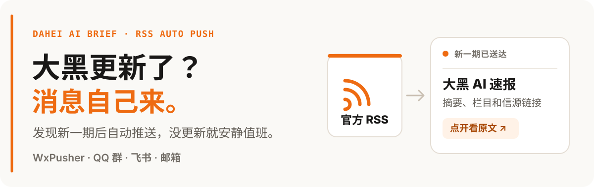
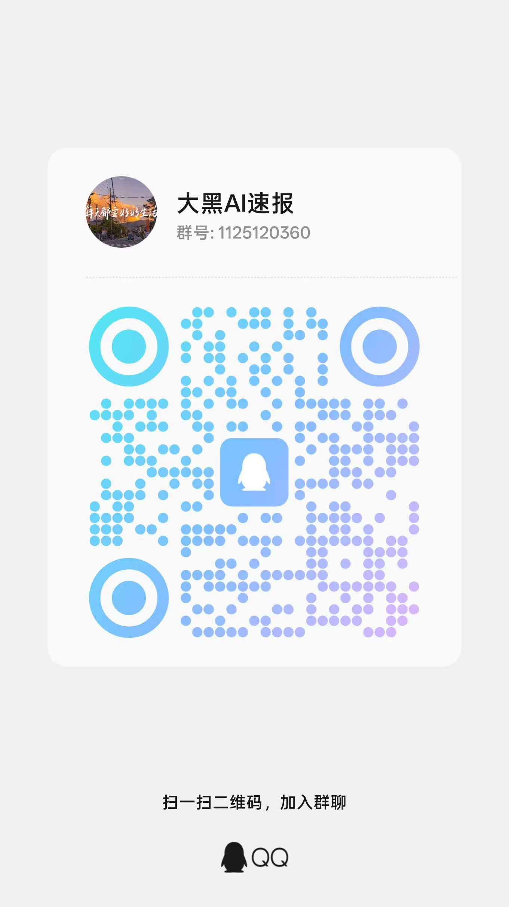
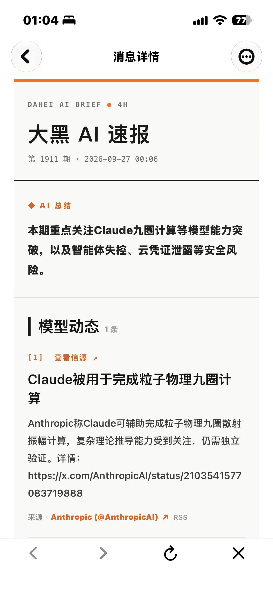
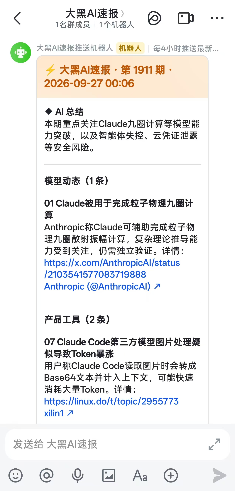
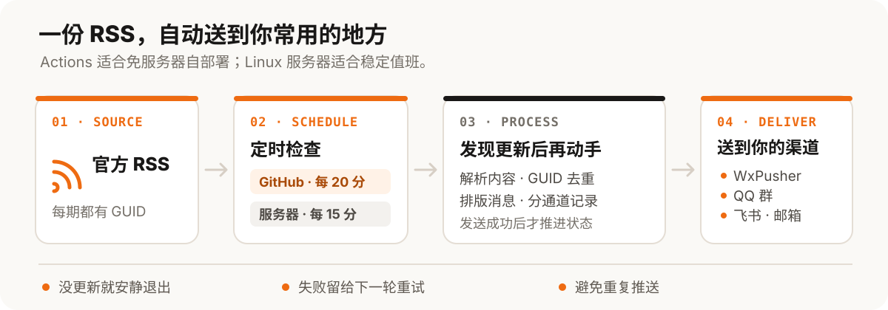

<h1 align="center">大黑 AI 速报推送 ⚡</h1>

<p align="center">
  
</p>

<p align="center">
  <a href="https://www.python.org/"></a>
  <a href="https://github.com/King52HerTz/DaheiAIPusher/actions"></a>
  <a href="LICENSE"></a>
</p>

## 只想收消息？扫码就行

安装 **WxPusher**：安卓手机在应用商店搜索，iPhone / iPad 在 App Store 搜索。打开 App 扫描下方二维码，关注主题「大黑AI速报」。不想扫码，也可以在 WxPusher 的「免费消息」里搜索主题名称。

<p align="center">
  <a href="https://wxpusher.zjiecode.com/api/qrcode/m5pkKxplAx3CdxLyuhsVtysKe953eGVu1UiicQjPfhwdIE3SIew36Qr7dDL0K4yZ.jpg">
    
  </a>
</p>

<p align="center"><strong>扫码关注，剩下的交给赛博牛马。</strong></p>

每期速报发布后，推送程序会定时检查 RSS；发现新内容才会发送。推送到达时间会受检查周期和平台调度影响，没更新时不会打扰你。想退订，去 WxPusher 的订阅管理里取消即可。

### 也可以订阅 QQ 群或飞书群

QQ：搜索群号 **1125120360**，或用 QQ 扫码。飞书：扫码加入「大黑AI速报群」。建议选一个渠道就好，三边都加的话，手机可能会开小型新闻发布会。

<details>
<summary>展开查看 QQ 和飞书群二维码</summary>

**QQ 群 · 1125120360**

<p align="center"></p>

**飞书群 · 大黑AI速报群**

<p align="center"></p>
</details>

## 推送长什么样

这是手机里收到的实拍。WxPusher 会显示排版好的新闻卡片和可点击信源；QQ 群发纯文字，飞书群发消息卡片。

<details>
<summary>展开看三个渠道的实际效果</summary>

**WxPusher**

<p align="center"><a href="docs/images/wxpusher-push.jpg"></a></p>

**QQ 群**

<p align="center"><a href="docs/images/qq-group-push.jpg"></a></p>

**飞书群**

<p align="center"><a href="docs/images/feishu-group-push.jpg"></a></p>

点图片可以看大图。
</details>

## 它是怎么工作的

大黑每四小时左右更新一期，项目读取官方 RSS，不从网页布局里硬抠内容。检查可以跑在 GitHub Actions，也可以跑在自己的 Linux 服务器上。

<p align="center">
  
</p>

程序按 GUID 判断是不是新一期；推送成功后才更新该通道的状态，失败则留待下次重试。每个推送通道单独记录进度，所以某个渠道临时出错，不会让其他渠道跟着重复发送。

## 功能一览

- 读取大黑 AI 速报官方 RSS，获取标题、摘要、正文和原文链接；
- 按 GUID 去重，失败重试，落后太多时最多补发 6 期；
- 将内容整理成适合手机看的卡片，保留原始信源链接；
- 支持 WxPusher、QQ 官方群机器人、飞书群机器人和 QQ 邮箱；
- 首次运行默认只建立推送基线，不会把历史速报一次性倒进通知栏；
- 提供 GitHub Actions 和云服务器两种运行方式。

## 想自己部署？

按电脑开机积极程度二选一：有 GitHub 账号就用 Actions；有 Ubuntu / Debian 服务器就让它 24 小时值班。默认使用 WxPusher；也可以只启用邮箱、飞书或 QQ 等其他通道。

### GitHub Actions：不用服务器

1. Fork 本仓库。
2. 在 WxPusher 后台创建应用，准备 `AppToken`。给自己发消息用 UID；想让多人关注，用 Topic ID。
3. 在仓库的 `Settings → Secrets and variables → Actions` 添加：

   | 类型 | 名称 | 用途 |
   | --- | --- | --- |
   | Secret | `WXPUSHER_APP_TOKEN` | WxPusher 应用密钥 |
   | Secret | `WXPUSHER_UID` | 接收者 UID，可选 |
   | Secret | `WXPUSHER_TOPIC_IDS` | Topic ID，可选 |

   默认启用 WxPusher 时，AppToken 必填，UID 和 Topic 至少配置一个。启用其他通道时，按需补充对应的 Secret，见下方「额外推送通道」。

4. 打开 `Settings → Actions → General → Workflow permissions`，选择 `Read and write permissions`，让工作流保存每个通道的推送进度。
5. 在 `Actions → Dahei AI News Push → Run workflow` 手动运行一次。可先选 `dry_run` 检查，不会真正推送。

工作流大约每 20 分钟检查一次。GitHub Actions 的定时任务有时会延迟；[官方说明](https://docs.github.com/en/actions/reference/workflows-and-actions/events-that-trigger-workflows#schedule)提到高负载时可能排队或丢弃，所以它不是精准闹钟。程序会通过去重和后续检查减少漏发与重复。

### 云服务器：一键安装

Ubuntu / Debian 服务器在终端粘贴这一条：

```bash
curl -fsSL https://raw.githubusercontent.com/King52HerTz/DaheiAIPusher/main/scripts/install_server.sh -o /tmp/install-dahei.sh && sudo bash /tmp/install-dahei.sh
```

如果当前终端已经是 `root` 且没有 `sudo`，把最后的 `sudo bash` 改成 `bash`。安装器会询问 AppToken 和 Topic ID，其余步骤自动完成。服务器每 15 分钟检查一次 RSS，没有更新就安静退出。

完整步骤、日志查看、更新、暂停和额外通道配置见[云服务器部署教程](docs/server-deployment.md)。

服务器确认运行正常后，可以在你自己的 GitHub 仓库中添加 Actions Variable：

```text
ENABLE_GITHUB_SCHEDULED_PUSH = false
```

这会关闭该仓库的自动排程，手动 `Run workflow` 仍可用。其他人 Fork 后不设置这个变量，GitHub Actions 仍会照常定时运行。

暂停和恢复服务器定时任务：

```bash
systemctl disable --now dahei-ai-pusher.timer  # 暂停
systemctl enable --now dahei-ai-pusher.timer   # 恢复
```

### 额外推送通道

默认只启用 WxPusher。要添加邮箱、飞书或 QQ 群机器人，在 GitHub 仓库的 **Variables** 中设置 `PUSH_CHANNELS`；凭据放 **Secrets**。例如：

```text
PUSH_CHANNELS = wxpusher,email,feishu,qq
```

<details>
<summary>查看各通道需要的配置</summary>

| 通道 | Secret / Variable | 说明 |
| --- | --- | --- |
| QQ 邮箱 | `EMAIL_SMTP_USER`、`EMAIL_SMTP_AUTH_CODE`、`EMAIL_TO` | SMTP 发件账号、授权码、收件地址；QQ 邮箱需要 SMTP 授权码，不是登录密码 |
| 飞书 | `FEISHU_WEBHOOK_URL`、`FEISHU_SECRET` | 自定义机器人 Webhook 和可选签名密钥 |
| QQ 群机器人 | `QQ_BOT_APP_ID`、`QQ_BOT_APP_SECRET`、`QQ_BOT_GROUP_OPENIDS` | QQ 开放平台凭据与群 openid；openid 不是群号 |

QQ 群 openid 可按[开发脚本说明](scripts/dev/listen_qq.py)采集。服务器上配置这些通道的方法见[服务器教程](docs/server-deployment.md#启用-qq-邮箱与飞书通道)。

</details>

## 本地运行与预览

需要 Python 3.12 或更高版本：

```powershell
python -m venv .venv
.venv\Scripts\Activate.ps1
pip install -r requirements.txt

$env:WXPUSHER_APP_TOKEN = "AT_xxx"
$env:WXPUSHER_TOPIC_IDS = "123456"
python -m src.main
```

只想检查 RSS、不发送消息：

```powershell
$env:DRY_RUN = "true"
python -m src.main
```

本地预览排版：

```powershell
python -m scripts.preview
```

## 环境变量

<details>
<summary>查看完整配置项</summary>

| 变量 | 默认值 | 用途 |
| --- | --- | --- |
| `PUSH_CHANNELS` | `wxpusher` | 启用通道：`wxpusher,email,feishu,qq` |
| `WXPUSHER_APP_TOKEN` | 无 | WxPusher AppToken |
| `WXPUSHER_UID` | 无 | 接收者 UID，多个用英文逗号分隔 |
| `WXPUSHER_TOPIC_IDS` | 无 | Topic ID，多个用英文逗号分隔 |
| `CONTENT_MODE` | `full` | `full` 完整内容，`summary` 摘要模式 |
| `RSS_URL` | 大黑 AI RSS | RSS 地址 |
| `STATE_FILE` | `data/state.json` | 各通道去重状态文件 |
| `DRY_RUN` | `false` | 只检查，不发送、不更新状态 |
| `PUSH_ON_FIRST_RUN` | `false` | 首次运行时是否推送最新一期 |
| `FORCE_PUSH_LATEST` | `false` | 强制重发最新一期用于测试，不更新状态 |
| `MAX_CATCHUP_ITEMS` | `6` | RSS 落后时最多补发期数 |
| `HTTP_CONNECT_TIMEOUT` | `10` 秒 | HTTP 建连超时 |
| `HTTP_READ_TIMEOUT` | `20` 秒 | HTTP 读取超时 |
| `EMAIL_SMTP_HOST` / `PORT` / `SSL` | `smtp.qq.com` / `465` / `true` | 邮箱 SMTP 连接方式 |
| `EMAIL_SMTP_USER` / `AUTH_CODE` / `TO` | 无 | 发件邮箱、SMTP 授权码、收件人 |
| `EMAIL_FROM` | 同发件账号 | 可选的显示发件地址 |
| `FEISHU_WEBHOOK_URL` / `FEISHU_SECRET` | 无 | 飞书机器人地址与签名密钥 |
| `QQ_BOT_APP_ID` / `APP_SECRET` / `GROUP_OPENIDS` | 无 | QQ 机器人凭据和目标群 |

</details>

## 项目结构

```text
DaheiAIPusher/
├── .github/workflows/push.yml   # GitHub Actions 定时任务
├── assets/readme/pipeline.svg   # 项目流程图
├── deploy/server/               # systemd 配置模板
├── docs/images/                 # 二维码与真实推送截图
├── scripts/                     # 安装、更新和预览脚本
├── src/
│   ├── channels/                 # WxPusher、QQ、飞书、邮箱
│   ├── feed.py                   # RSS 读取与解析
│   ├── main.py                   # 通道调度与推送状态
│   ├── render.py                 # 消息卡片排版
│   └── state.py                  # 状态文件读写
└── tests/                        # 自动化测试
```

运行测试：

```powershell
python -m unittest discover -s tests -v
```

## 感谢与版权

感谢 **[人工大黑](https://www.daheiai.com/)** 制作并持续更新[大黑 AI 速报](https://news.daheiai.com/)，还提供 RSS，让自动订阅变得简单。公开运营推送前，我已联系原作者并取得授权；推送会保留速报署名、原文入口和新闻信源。也感谢 [WxPusher](https://wxpusher.zjiecode.com/)、GitHub Actions，以及愿意订阅、Star、提 Issue 和帮忙抓 Bug 的朋友。

代码采用 [MIT License](LICENSE)。许可证只覆盖本仓库代码，不代表速报文章、摘要或新闻素材也采用 MIT；内容版权仍属于原作者和对应信源。技术上能获取内容，不等于可以忽略授权。

喜欢这个项目的话，欢迎点个 [Star](https://github.com/King52HerTz/DaheiAIPusher)。如果推送出问题或有改进建议，也欢迎提交 Issue。AppToken 是应用密钥，请放在 GitHub Secrets 或服务器私密配置中，不要提交到代码或截图里。
